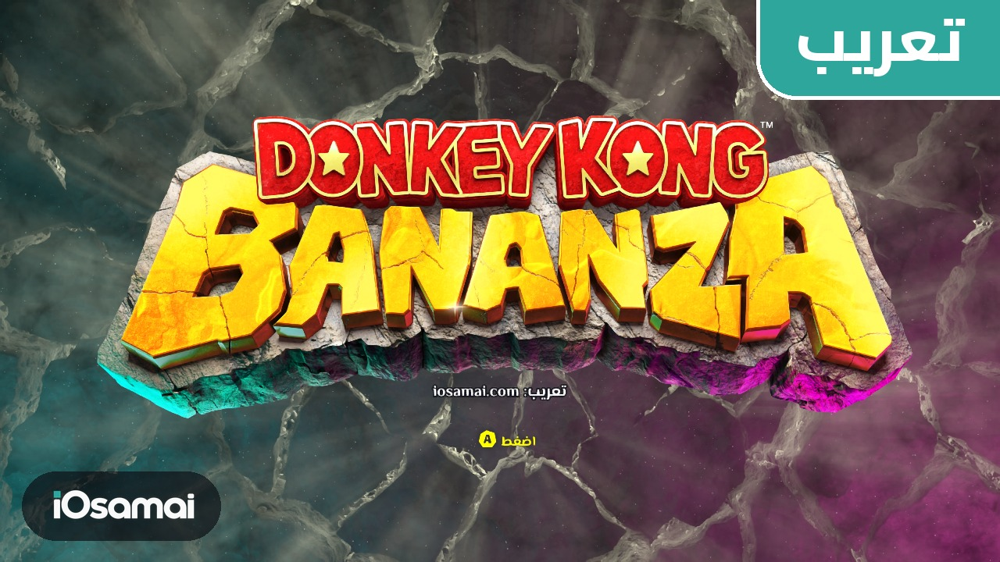
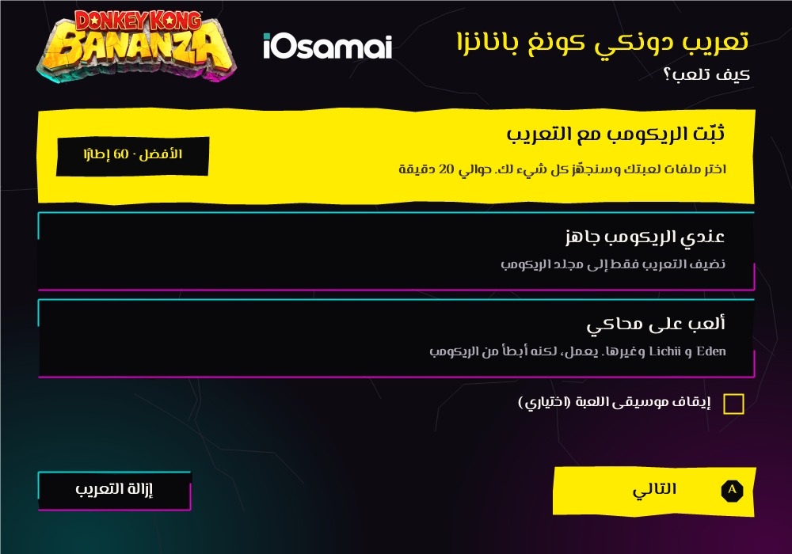
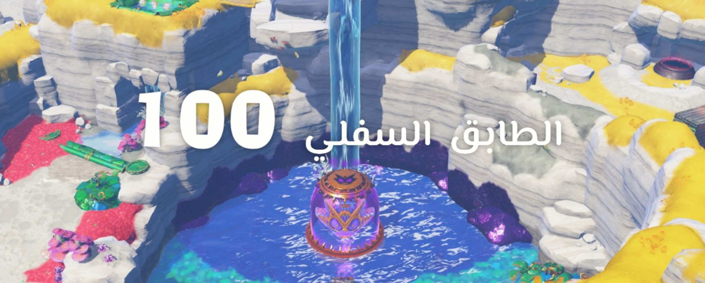
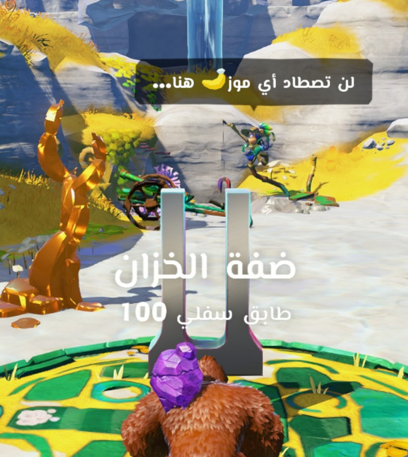
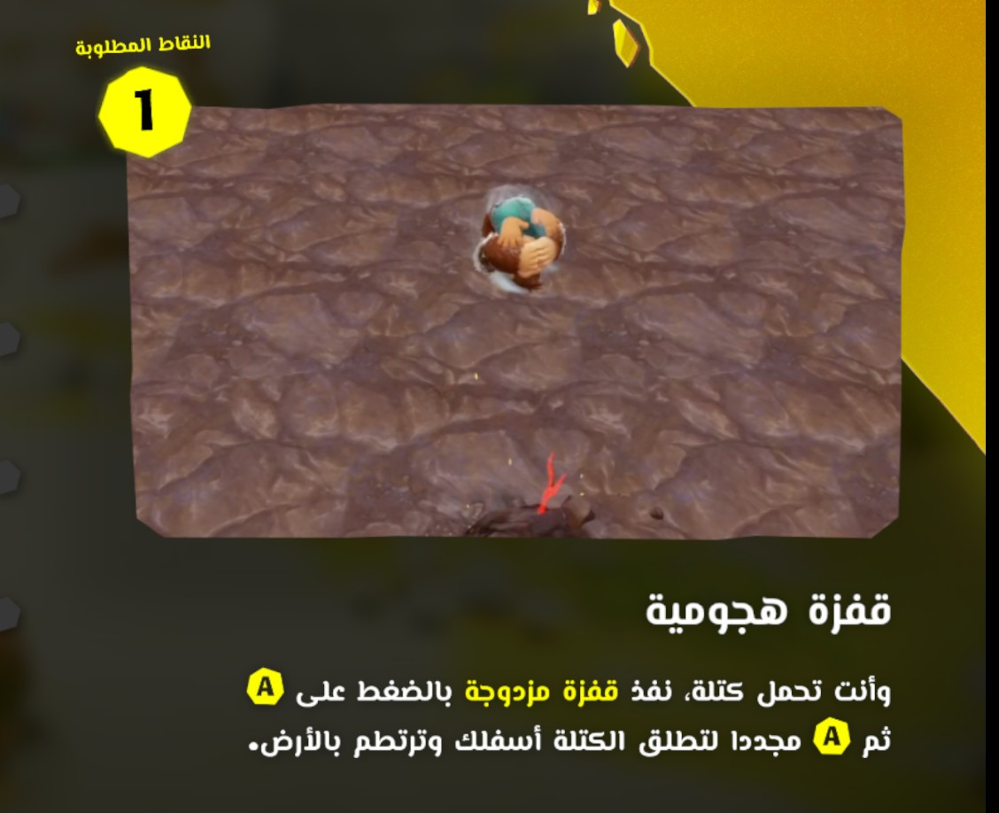
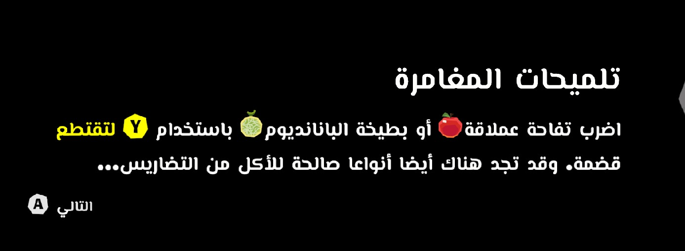
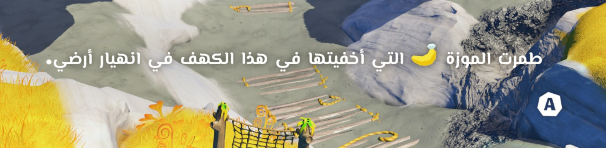
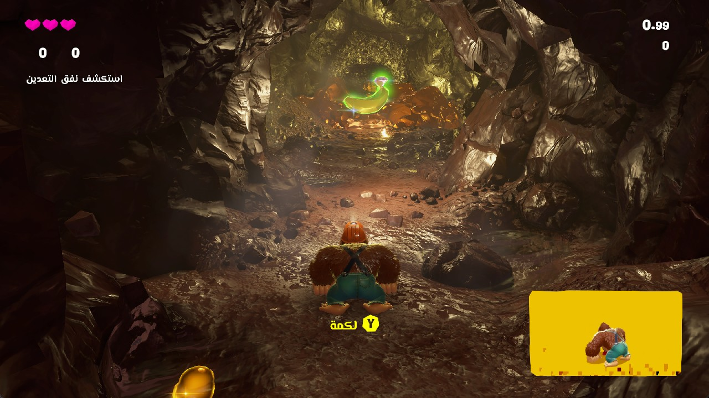

# تعريب Donkey Kong Bananza | Donkey Kong Bananza Arabic

تعريب Donkey Kong Bananza (دونكي كونغ بانانزا) على نينتندو سويتش 2، الإصدار 3.2.0: الحوارات، القوائم، التلميحات، أسماء الأماكن والأدوات. شارات النهاية تبقى بالإنجليزي.

> **تعريب فقط، بدون أي ملفات من اللعبة.** لازم تكون عندك نسختك الخاصة من اللعبة. هذا المستودع ما فيه لعبة ولا مفاتيح ولا روابط تحميل لها.

## اللي تحتاجه

1. ملفات لعبتك بالإصدار **3.2.0**: إما مجلد فيه `base` و`updates`، أو ملف `nup.`.
2. جهاز Windows.
3. مساحة فاضية: حوالي **44 جيجابايت** للمجلد، أو **34 جيجابايت** لملف `nup.`.

## التثبيت

حمّل [`DKB-Arabic-1.0.zip`](https://github.com/OSAMAxALHARBI/DonkeyKongBananza-Arabic/releases/latest/download/DKB-Arabic-1.0.zip) من [Releases](../../releases/latest)، فك ضغطه وشغّل `DKB-Arabic.exe`. البرنامج يسألك كيف تلعب:

### 1) ثبّت الريكومب مع التعريب (الأفضل)

اختر ملفات لعبتك ومكان التثبيت. البرنامج يتأكد إن نسختك 3.2.0، ينزّل [الريكومب](https://github.com/Lucas-blip-png/dkb-pc-recomp) من صفحته الرسمية، يبنيه من ملفاتك، ويضيف التعريب. يأخذ حوالي 20 دقيقة أو أكثر على الأجهزة الأضعف. هذا الخيار يشغّل اللعبة على الكمبيوتر مباشرة بـ 60 إطارًا.

### 2) عندي الريكومب جاهز

اختر المجلد اللي فيه `dkb.exe`، والبرنامج يضيف التعريب فقط.

### 3) ألعب على محاكي

للمحاكيات من عائلة Eden مثل Lichii وAnka. يعمل، لكنه أبطأ بكثير من الريكومب.

## إيقاف الموسيقى

اللعبة ما فيها خيار لإيقاف الموسيقى. في البرنامج مربع اختياري يوقفها، والأصوات والمؤثرات تبقى.

## الإزالة

افتح البرنامج واضغط «إزالة التعريب».

## ملفات المود

للتثبيت اليدوي: [`DKB-Arabic-1.0-Mod-Files.zip`](https://github.com/OSAMAxALHARBI/DonkeyKongBananza-Arabic/releases/latest/download/DKB-Arabic-1.0-Mod-Files.zip). مجلد `Emulators` يوضع في مجلد المودات، ومجلد `PC-Port/ArabicDKB` يوضع مساره في `romfs_mods` داخل `dkb.ini`. يعمل مع 3.2.0 فقط.

## ملاحظات

- التعريب يعمل مع الإصدار 3.2.0 فقط.
- مجرب على جهاز واحد. إذا واجهت مشكلة، راسلني من [iosamai.com](https://iosamai.com).
- الخط: El Messiri، برخصة SIL OFL 1.1 (`OFL-ElMessiri.txt`).

## صور من اللعبة

---

## English

Arabic translation of Donkey Kong Bananza (Nintendo Switch 2), version 3.2.0: dialogue, menus, tips, place and item names. The credits stay in English.

**Translation only, with no game files.** You need your own copy of the game. This repository contains no game, keys or download links for them.

**You need:** your own game files, version 3.2.0 (a folder with `base` and `updates`, or a `.nup` file), Windows, and about 44 GB free for a folder or 34 GB for a `.nup`.

**Install:** download [`DKB-Arabic-1.0.zip`](https://github.com/OSAMAxALHARBI/DonkeyKongBananza-Arabic/releases/latest/download/DKB-Arabic-1.0.zip), unzip it and run `DKB-Arabic.exe`.

1. **Install the port with the translation (recommended):** pick your game files and a destination. The program checks for version 3.2.0, downloads the [port](https://github.com/Lucas-blip-png/dkb-pc-recomp) from its official page, builds it from your files and adds the translation. It takes about 20 minutes, longer on weaker PCs. This runs the game natively at 60 fps.
2. **I already have the port:** pick the folder with `dkb.exe`.
3. **Emulator:** for Eden-family emulators such as Lichii and Anka. It works, but it is much slower than the port.

**Music off:** the game has no option for this. An optional box in the program turns the music off and keeps voices and sound effects.

**Remove:** open the program and press the remove button.

**Mod files for manual install:** [`DKB-Arabic-1.0-Mod-Files.zip`](https://github.com/OSAMAxALHARBI/DonkeyKongBananza-Arabic/releases/latest/download/DKB-Arabic-1.0-Mod-Files.zip). Version 3.2.0 only.

Tested on one PC so far. Report problems at [iosamai.com](https://iosamai.com). Font: El Messiri, SIL OFL 1.1.
